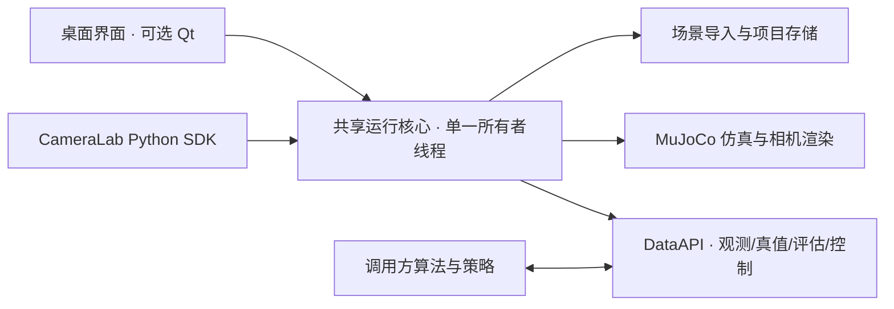

# Python SDK

从 0.2.0 起，核心可以作为 Python 包使用，不依赖 Qt；桌面与 SDK 共用同一个 MuJoCo 工作线程实现。原来的 RenderSession、DataAPI 和桌面启动入口仍可使用。

## 模块关系



runtime.py 管理命令串行化、运行状态与线程生命周期；sdk.py 提供公开同步方法；app.py 负责桌面交互。project、render、sim、api 沿用既有职责。只导入数据契约不会加载 MuJoCo 或 Qt，方便独立算法模块使用类型。

## 安装与运行

在仓库根目录安装核心：

```bash
python -m pip install -e .
```

需要桌面再安装 `python -m pip install -e '.[desktop]'`。运行所有测试使用 `.[test]`。无界面不等于无图形依赖，MuJoCo 仍需可工作的 OpenGL 后端；本机验证使用 EGL。

```bash
MUJOCO_GL=egl python examples/sdk_capture.py
```

示例保存三路 RGB、深度、有效掩码的 NumPy 文件与相机标定。使用本机源码而不安装时，可设置 `PYTHONPATH=src`；SDK 不需要 `.runtime/python-deps` 中的 Qt。

## 手动步进

```python
from camera_lab import CameraLab

with CameraLab(width=1280, height=720) as lab:
    # 未指定模型时加载内置演示场景，但 SDK 不会自动运行物理。
    lab.step(steps=10)
    observation = lab.capture()
    rgb = observation.frames[0].rgb
    depth = observation.frames[0].depth
```

默认处于 edit，物理时间不推进，也不持续生成图像。step 推进正整数个模型 timestep 并进入 paused；capture 不推进物理。run 启用实时推进和连续采样，pause 等待暂停命令执行完成；在运行中调用 capture 得到执行该命令时的状态，随后实时仿真仍可继续。

需要一对同步真值进行评估时，显式调用 `observation, truth = lab.capture_with_truth()`。两者的完整 FrameStamp 相同。算法输入优先只用 capture 或观测订阅，避免把真值交给估计算法。

## 场景与项目

```python
with CameraLab() as lab:
    lab.scene.load('examples/models/table.xml')
    lab.scene.append('examples/models/simple_robot.urdf', position=(0, 0, .75))
    lab.scene.set_pose('model_0001/base', position=(.1, 0, .75))
    bodies = lab.scene.describe()
    lab.save_project('experiment.camproj')
    lab.load_project('experiment.camproj')
```

load/append 读取 MJCF 或 URDF；保存的 .camproj 用 load_project 恢复。模型加载或保存仍按桌面规则暂停仿真，物体编辑重置全场景初态。save_initial 将当前关节/mocap 姿态作为初态；reset 恢复初态并生成新的 run_id。

load/append 可传 `packages={'包名': '/包目录'}`；映射应用于本次导入。构造参数 packages 只用于启动模型。旋转使用 wxyz 四元数，单位与坐标语义见 [场景编辑](scene-editor.md)。

SDK 指定无效启动模型时抛出异常，且不会留下工作线程；桌面仍保留原来的示例回退行为。运行中导入失败保留原有效场景，调用者可捕获异常后继续操作。

## 相机配置

```python
with CameraLab() as lab:
    name = lab.cameras.describe()[0]['name']
    lab.cameras.configure(name, width=640, height=480,
                          fx=500, fy=500, cx=319.5, cy=239.5,
                          near=.01, far=20,
                          parent='world', position=(0, -2, 1))
    lab.cameras.aim(name, 'red_box')
    lab.cameras.move(name, dx=10, dy=0, steps=1)
```

configure 只替换传入字段，其余保留。只改标定保留源模型的跟踪/目标相机模式；显式编辑位姿则与桌面一致，改为相对父对象固定的相机。改变尺寸不会自动缩放内参；请根据需要同时设置 fx/fy/cx/cy。位姿字段为 parent/position/rotation，rotation 使用光学坐标下的 wxyz 四元数。改变挂载父对象后，位置和旋转按新父坐标系解释，不自动保持世界位姿。相机操作保持当前运行或暂停状态。

move 与桌面拖动/滚轮语义一致：dx/dy 每单位沿相机局部 X/Y 移动 0.005 米，steps 每单位沿光轴移动 0.1 米；它不是焦距变焦。

## 实时订阅

```python
from queue import Empty
from time import sleep
from camera_lab import CameraLab

with CameraLab(fps=30) as lab:
    images = lab.data.subscribe_observations()
    lab.run()
    for _ in range(100):
        try:
            observation = images.get_nowait()
        except Empty:
            sleep(.01)
            continue
        # 在这里运行算法；慢消费者丢旧批次，不堵塞渲染线程。
        print(observation.stamp, observation.frames[0].rgb.shape)
    lab.pause()
```

lab.data 是原 DataAPI；可使用 subscribe_truth、evaluate、actuators、submit_control 和 subscribe_control_results。观测与真值应按完整 FrameStamp 匹配，不能按两个队列的取出顺序匹配。

## 控制与评估

手动策略循环可按“capture → 计算动作 → submit_control → step”执行。ControlCommand 的 target_step 使用当前观测的 step_index，命令在该步下一次积分前生效；实时模式应为推理延迟预留未来步。调用 submit_control 只是入队，必须检查控制结果订阅；有效期、执行器范围与版本校验不变。

PoseEstimate、ControlCommand、CameraConfig 可从 camera_lab 根包导入。位姿评估、时效机制和数据字段详见 [数据与控制接口](data-control-api.md) 与 [相机契约](camera-data-api.md)。纯 URDF 不自动生成 actuator。

## 生命周期、并发和错误

- 使用 with 或显式 close。close 可重复调用，等待当前操作与 MuJoCo/OpenGL 资源清理；尚未执行的排队请求被拒绝，关闭后的 SDK 命令抛出 RuntimeError，订阅随之关闭。
- 命令同步返回，完成表示已在唯一所有者线程执行；多调用线程的命令串行化，但多个独立调用不构成事务。队列容量 64，过载抛出 queue.Full。
- SDK 不把 MuJoCo model/data 暴露给其他线程；describe 返回副本，图像与变换沿用只读契约。
- 调用没有隐式超时，避免出现“调用超时但后台继续修改场景”的歧义。大模型加载、很长的 step 和资源关闭可能耗时；不要在 UI 主线程中直接做这些阻塞操作。
- 不在 MuJoCo 线程执行用户算法回调。算法由调用方或自己的线程运行。
- 非法参数、缺失文件、编译/保存错误会返回给调用者；不会假装成功。运行时不可恢复错误会关闭订阅并拒绝后续命令。

本轮不包含网络服务、ROS 2 或真实视觉/策略算法；这些接入可建立在相同的观测和控制契约上。
